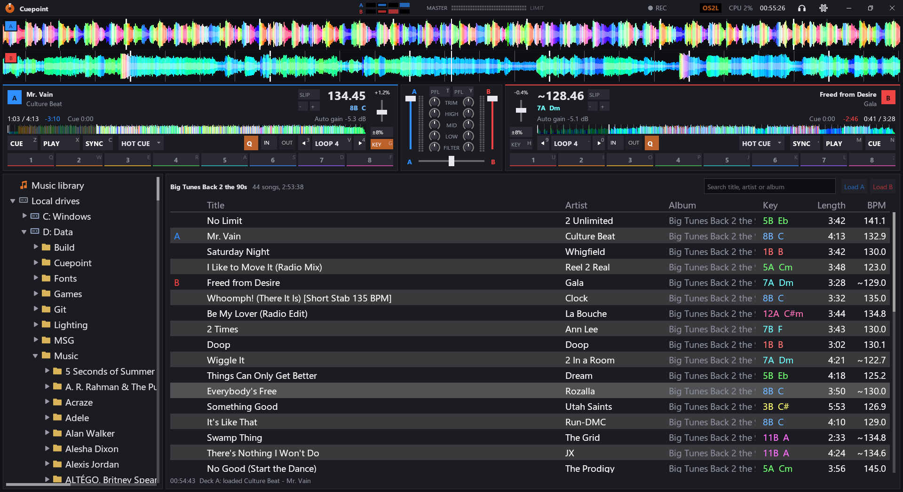

# Cuepoint

Cuepoint is a two-deck DJ app for Windows, built for mixing from a library of music files with a keyboard, a mouse or a DJ controller. It analyses every song's tempo, beat grid, key and loudness, keeps the decks in sync, and works with Pioneer's DDJ-SB3 out of the box, including its FX FADE and PAD SCRATCH effects.



It's written in C# on .NET 10. It draws its own interface with Vulkan through [BRUTAL](https://www.nuget.org/packages?q=Ahwoo.BRUTAL) (GLFW, Vulkan, FreeType) and mixes audio with SDL3_mixer.

## Features

### Decks

- **Two decks:** play, cue (with a preview while held), sync and key lock on each.
- **Tempo fader:** ±8%, ±16% or ±50%.
- **Hotcues:** eight per deck, kept with each song.
- **Loops:** from 1/16 to 32 beats, fitted to the beat grid, with halve and double.
- **Loop rolls:** on the pads in ROLL mode. A roll loops for as long as its pad is held, then drops back in where the song would have got to.
- **Scratching and backspins:** from a controller's jog wheel. The record follows the wheel, backwards too.
- **Waveforms:** a scrolling waveform for each deck, coloured by bass, mids and treble. When synced, both decks scroll at the same rate. There's also an overview of the whole song with its hotcues, loop and beat grid.
- **End-of-song warning:** in a song's last 30 seconds, the remaining time and the end of its overview flash red.

### Analysis

Each song is analysed in the background as it comes into view in the list. The analysis finds:

- its beat grid, including songs whose tempo drifts
- the downbeats
- its key, shown as a Camelot code
- its loudness, for automatic gain

**Fixing a beat grid by hand:** in a deck's **GRID** mode, the pads become tools.

- **Pinning beats:** pin a beat to the music, set the downbeat, nudge, halve or double the tempo, make it steady, or reset it.
- **Dragging:** any beat line on the scrolling waveform can be dragged onto the music.
- **Several pins:** each pin sets the tempo between it and the next, so songs that speed up or slow down can be fixed too.

### Mixer

- **Each channel:** a trim, a three-band EQ with kills, a filter, a level meter, a fader, and headphone cue (PFL).
- **Crossfader**, and automatic gain for each song.
- **Outputs:** the main mix and the headphones can go to separate sound cards, or the headphones can use channels 3 and 4 of a four-channel controller's sound card.

### Library

- **Folder list:** the music library, every drive's folders, virtual folders, History, Recently added, and live filters such as songs compatible in key and tempo with each deck.
- **Recursive folders:** a folder, drive or the music library lists only the songs directly in it. Right-click it and choose **Recursive** to list every song in its subfolders too, until another folder is chosen.
- **Song list:**
  - searchable
  - sortable by any column
  - resizable columns, which can be shown or hidden
  - marks the songs loaded on each deck and those played this session
- **Virtual folders:** playlists you put together by dragging songs onto them, saved as `.m3u8` files. They can be stored on any drive. One kept on a removable drive goes with it, and its songs are found again under whatever drive letter it gets.
- **Drag and drop:** drag songs onto a deck to load them, from the list or from outside the app.
- **Large text:** turned on in the options, the folder list and song list use bigger text, and the folder list bigger icons, to read in the dark or without glasses.
- **Where analyses, hotcues and fixed grids are kept:** with the songs themselves.
  - **On the system drive:** in the app's own `library.json`.
  - **On any other drive:** in a `Cuepoint\library.json` at that drive's root.

### Controllers and lighting

- **MIDI controllers:** they're found as they're plugged in. Any control can be learned to any function, and lit buttons follow what the decks are doing.
- **Pioneer DDJ-SB3:** mapped out of the box. That includes its loop rolls (Shift + FX FADE), the FX FADE transitions (filter sweeps, loop fade out, loop chop and backspins) and the PAD SCRATCH patterns.
- **Lighting:** what each deck is doing, and every beat, is sent to lighting software over [OS2L](https://os2l.org/), including the SoundSwitch extensions. The software is found on the network by itself. While OS2L is on, the title bar shows **OS2L** in green once it's connected, and pulsing orange while it's still looking.

### While a set is running

- **Keeps the computer awake:** while the window is visible, the computer won't sleep and the screen won't switch off.
- **Remembered between runs:** the audio devices, the music library's folder, the song list's layout and the last folder or virtual folder chosen.

## Keyboard

Each deck has its own side of the keyboard.

| | Deck A | Deck B |
|---|---|---|
| Hotcues 1–8 | Q W E R A S D F | U I O P J K L ; |
| Cue, play, sync, loop | Z X C V | N M , . |
| Halve / double loop | 3 / 4 | 9 / 0 |
| Tempo down / up (Shift: volume) | 5 / 6 | 7 / 8 |
| Headphone cue, key lock | T, G | Y, H |
| Kill low / mid / high, reset EQ | F1 F2 F3, F4 | F9 F10 F11, F12 |
| Low-pass / high-pass filter | F5 / F6 | F7 / F8 |

- **Hotcues:** Shift with a hotcue key clears it. In GRID or ROLL mode, the hotcue keys work the pads instead.
- **Faders:** they move while their keys are held, a quarter as fast with Ctrl.
- **Crossfader:** `[` and `]` slide it, and `B` centres it.
- **Loading songs:** `1` loads the selected song onto deck A and `2` onto deck B.

## Building and running

You'll need:

- Windows 10 or later
- the .NET 10 SDK
- a graphics card with Vulkan support

```
dotnet run --project Brutality -c Release
```

The music library starts out as your Windows Music folder. To use another folder, right-click it in the folder list and choose **Use as music library**.

Settings and the library's analyses are kept in `%LOCALAPPDATA%\Cuepoint`.

The app's images are drawn by [Assets/draw_assets.py](Brutality/Assets/draw_assets.py), which needs only Python 3. Run it again after changing them.

## License

[MIT](LICENSE)
