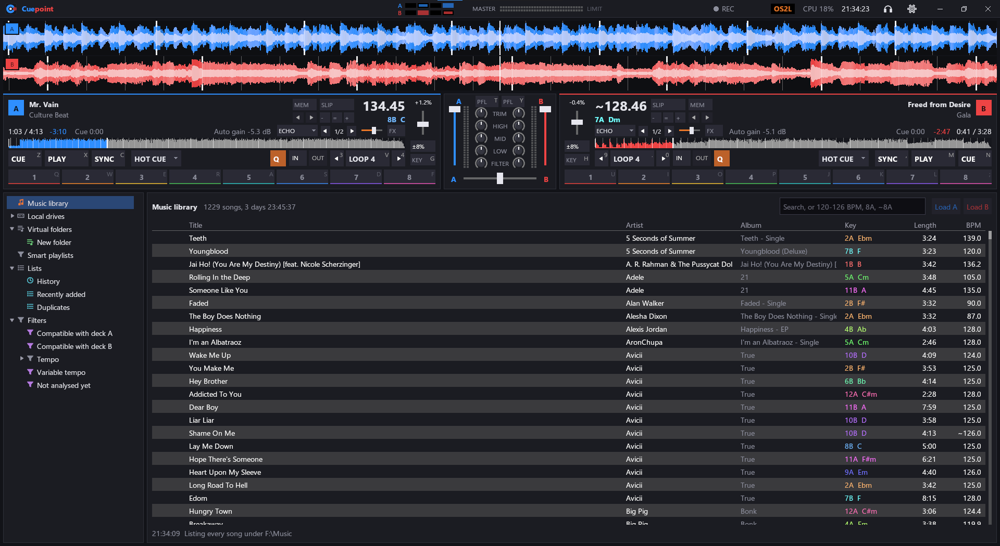

# Cuepoint

Cuepoint is a two-deck DJ app for Windows (and, newly and not yet tried, Apple Silicon Macs: see [On a Mac](#on-a-mac)), built for mixing from a library of music files with a keyboard, a mouse or a DJ controller. It analyses every song's tempo, beat grid, key and loudness, keeps the decks in sync, and works with Pioneer's DDJ-SB3, DDJ-FLX4 and DDJ-400 out of the box, including the SB3's FX FADE and PAD SCRATCH effects.



It's written in C# on .NET 10. It draws its own interface with Vulkan through [BRUTAL](https://www.nuget.org/packages?q=Ahwoo.BRUTAL) (GLFW, Vulkan, FreeType) and mixes audio with SDL3_mixer.

## Features

### Decks

- **Two decks:** play, cue (with a preview while held), sync and key lock on each.
- **Sync lock:** **SYNC** (C or `,`, or a controller's SYNC) locks a deck to the other: it takes the other's tempo and follows it as it changes, and while both play it keeps to the other's beat too, leaning on its speed rather than jumping, as Auto-Mix does. A deck that starts playing while locked comes in on the beat. SYNC is lit while it's locked, and faintly while the tempos only happen to match. One deck follows at a time, so locking one unlocks the other, which leads. Press SYNC again to let go, or move the locked deck's own tempo, which lets go too.
- **Cover pictures:** a song's cover, as tagged in an MP3 or M4A (and a FLAC, where Windows reads FLAC tags), shows small beside its title and artist, so which song is on which deck reads at a glance. A song without one leaves a plain square there. Windows decodes the pictures, so this is on Windows only.
- **Tempo fader:** ±8%, ±16% or ±50%.
- **Key shift:** a deck's **-** and **+** (beside its key) move the key down or up a semitone, as far as an octave, without changing the tempo, to bring a song into a key that mixes with the other deck. The key shown moves with it. Right-click either to put the key back. A new song starts in its own key.
- **Key match:** a deck's **=** (between **-** and **+**) shifts its key as little as it takes to mix with the other deck's: to the same key, or its relative major or minor, the same number on the Camelot wheel. Key lock goes on with it, so the tempo fader doesn't pull the key away again. **=** is lit while the two decks' keys match.
- **Effects:** remembered between runs, apart from being on, and on the DDJ-SB3 VINYL switches a deck's effect on and off and Shift + KEY LOCK picks the next. Each deck has an echo, a reverb, a flanger, a gate and a bit-crusher, one at a time, chosen from the list beside its times. **FX** switches it on and off, the slider sets how much, and the arrows set its length in beats (1/8 to 16): how far apart the echoes are, how long the flanger takes to sweep, or how long the gate takes to open and shut, in time with the deck's tempo and kept on its beat. The gate lets the first half of each length through and shuts the second, all the way at full level; the crusher makes the sound rough and lo-fi, more so the higher it's turned. Switched off, the echo and reverb ring on and fade, as a DJ mixer's do. They can be learned to a controller's buttons and knobs too.
- **Effects to the next phrase:** right-click a deck's **FX** for an **echo out** or a **filter sweep** that builds to the next phrase (eight bars from the song's first downbeat, at least a bar away) and finishes there, as a transition would. An echo out echoes from the press, cuts the song's sound on the phrase so only the repeats ring on for two bars, then stops the deck; a filter sweep raises the high-pass to the phrase and drops it back on it. Either puts the deck's EQ, filter and effect back as they were when it's done, pressed again, or the deck's stopped. They need a song with a beat grid, and can be learned to a controller's buttons.
- **Slip:** with a deck's **SLIP** lit (Shift + VINYL on the DDJ-SB3), a scratch, a backspin, a hotcue held down or a loop lasts only while it's held or looping. The song carries on underneath, shown as a dashed line on the overview, and when you let go the deck drops back in where it would have got to, so the mix stays in time.
- **Hotcues:** eight per deck, kept with each song.
- **Undo:** Ctrl + Z takes back the last hot cue or beat grid change, and again for the one before, up to 100, even after the song has left the deck. It takes back changes to the library's lists too: songs taken out of a virtual folder or put in another order, a virtual folder deleted, a smart playlist deleted, Auto-Mix's list put in another order, and the panic.
- **Panic:** Ctrl + Backspace, or a controller button learned to it, puts everything colouring the sound back to neutral at once, for when something's gone wrong and there's no time to find what: every deck's EQ, filter and trim to the middle and its kills forgotten, its key back to the song's, its effect off and any loop left, and the master effect off. The music plays on, and the faders and crossfader stay where they are, so a deck meant to be out stays out. Ctrl + Z puts the settings back, all but the loops.
- **Memory cues:** **MEM** adds a memory cue where the deck is, or takes away the one it's at, and the arrows beside it go to the previous or next one, making it the cue point. They show red on the overview, are kept with the song, and can be undone. A memory loop imported from Rekordbox or Serato is ready for reloop once you've jumped to it.
- **Hot cue names, colours and hot loops:** right-click a set hot cue's pad to **Rename...** it, give it a **Colour**, or make it a **Hot loop** of 1 to 32 beats from where it is, by the beat grid, or not a loop; **Clear** is there too. A name shows on the pad and in the countdown to it, a colour on the pad and its marks, and a hot loop's pad jumps there and loops. They're kept with the song, and Ctrl + Z takes each change back. Those from Rekordbox and Serato come in the same way.
- **Suggested hot cues:** right-click an empty pad and choose **Suggest hot cues for this song** for hot cues at its start (the first downbeat), its drop (where the intro ends), its breakdown and second drop (the first four bars or more where the bass falls away, and where it comes back) and its outro, from its analysis. They go on the empty pads, named and coloured, leaving any hot cues set alone, and none within a bar of one there already; Ctrl + Z takes them back.
- **Cue points:** kept with each song too. It waits at its cue point when it's loaded.
- **Auto cue:** a song with no cue point or memory cue of its own loads cued to where its music starts, on the beat nearest its first sound, rather than to the silence before it. It's on to begin with, and can be turned off in the options.
- **Load protection:** a song can't be loaded onto a deck that's playing into the main mix, so a stray key press or drag can't stop the music. A deck with its fader down, or only in the headphones, can still be loaded. It can be turned off in the options.
- **Loops:** from 1/16 to 32 beats, fitted to the beat grid, with halve and double.
- **Moving a loop:** right-click the arrows either side of the loop button to move the loop playing back or on a beat, the same length, the music going with it so it stays in time. Ctrl with the halve and double keys does the same, and Ctrl + Shift moves it a bar. A controller's buttons can be learned to move it a beat or a bar either way.
- **Loops set by hand:** **IN** marks where a loop starts and **OUT** loops back to it from there, on the beat with quantise on. Pressed while it loops, OUT moves its end. Halve and double work on it too, and reloop goes back to the loop's start, or plays the last loop again. They work without a beat grid as well.
- **Censor:** hold Ctrl with a deck's play key (Ctrl + X for A, Ctrl + M for B), or a controller button learned to it, and the song plays backwards at the deck's speed, as a word kept off the air is. Let go and it drops back in where the song would have got to, whether **SLIP** is lit or not.
- **Pad modes:** the list beside SYNC sets what the pads do: HOT CUE, ROLL, BEAT JUMP, SAMPLER, STEMS or GRID.
- **Stems:** in STEMS mode the song is separated into its vocals, drums, bass and instruments with Meta's Demucs, in the background, and pads 1 to 4 turn each on and off while pads 5 to 8 play just that one (or everything again). The first pad shows how far separating has got. With nothing playing it's done on the graphics card (DirectML), about 20 seconds for a four-minute song; while a deck plays it moves to the processor, on half its cores, taking about as long as the song, since the graphics card's work would make the screen stutter. If the graphics card ever gives wrong results, the song's separated again on the processor, which is used from then on. The stems are kept on disk, so a song separated once has them as soon as it's loaded. All four on is the song exactly. The model isn't shipped with Cuepoint: `tools/export_demucs.py` makes it (instructions at the top of the script).
- **DJ edits:** **Make a DJ edit...** on a song's right-click menu asks how to make it, then makes a new song from it with 16 bars of its own drums, taken from its drum stem, before it starts and after it ends, to mix in and out over beats alone. Halfway through each something changes, from the same bars as the drums: the song's bass comes in after 8 bars of the intro and drops out for the last 8 of the outro; failing bass, its instruments do; and with neither, the kick drops out for a bar instead. The intro ends on the song's first downbeat (after a bar or two of quiet lead-in, if it has one): it leaves a gap for a drum fill the song starts with, so the fill takes over, and otherwise carries on under any lead-in (a voice, say), rolling into the song with a fill if it comes straight in on its drums, or if it doesn't, landing on its first beat with a hit that dies away, along with the bass. The outro carries on from where the song's drums stop, or where it starts fading out; a song that carries on past its drums with an ending of its own has that heard out, the beats coming in on the phrase line where it's dying away. It runs for at least 16 bars to the end of a phrase (counted in 8-bar phrases from the first downbeat), and finishes on a last hit. The loops are the steadiest bars of drums near where they meet the song, no louder than its drums there. An end that has 8 bars of beats without vocals already is left alone, and a song with both, or with a title that says it's an extended mix, DJ edit or intro version, isn't edited at all. The edit is saved beside the song as a 16-bit FLAC (lossless, about half the size of a WAV), titled with "(Cuepoint DJ Edit)" in place of any "(Radio Edit)", "(Original Mix)" or the like, with the song's beat grid, hot cues and memory cues moved along, memory cues where the song starts and where the outro begins, and cued to its first beat. The original notes the edit made of it in its library entry. Once there's an edit, the menu says **Remake the DJ edit...**, which asks before replacing it (not while it's on a deck); remaking one made before as a WAV makes it a FLAC, and the WAV goes to the Recycle Bin, or is deleted where its drive has none, as the question says. The song's separated into its stems first if it hasn't been, and then once the edit's made, Cuepoint offers to delete those stems, saying how much room they take, unless the song's on a deck.
  - **How it's made:** the dialog sets each end's length (8, 16 or 32 bars), what changes halfway (Auto, nothing, the bass, the instruments, both, or a bar without the kick), how the intro's beats give way to the song (Auto, a hit dying away, a fade, a filter sweep, an echo, or a cut), over how long (a beat to 8 bars), and whether before the song starts or across its start, under its first bars, which suits a song that starts with a voice alone. The outro's beats can come straight in, fade in or filter in, after the song's beats stop or under its last bars, and end with a hit, a fade, a filter sweep, an echo or a cut, over how long. Echoes repeat every half, three quarters of, one or two beats. **Defaults** puts everything back to Auto. Each song keeps the choices its edit was made with, for making it again, and the next edit starts from the last.
- **Sampler:** sixteen one-shot samples, an air horn or a drop, say, in two banks of eight, played into the main mix from the pads in SAMPLER mode (the first bank) or SAMPLER 2 (the second), the same on either deck, whether or not it has a song loaded; a controller's SAMPLER pressed again flips between them. Right-click a song and choose **Put on sampler pad** to put it on one; hitting its pad (or its key) plays it from the start, lit while it plays, and Shift-click takes it off. They're kept between runs, and play past the crossfader, under the master volume.
- **Sampling from a deck:** right-click a sampler pad to sample either deck into it: the loop playing, or else the bar up to the beat just gone. It's kept as a WAV in Cuepoint's own folder (in the settings backup too), named for the song.
- **Loop rolls:** on the pads in ROLL mode. A roll loops for as long as its pad is held, then drops back in where the song would have got to.
- **Beat jumps:** on the pads in BEAT JUMP mode (Shift + HOT CUE on the DDJ-SB3), in pairs, back or on by 4, 8, 16 or 32 beats, staying in time, each pad with an arrow the way it goes. A loop moves with the jump.
- **Quantise:** with a deck's **Q** lit, hotcues and the cue point go on the nearest beat, and jumping to a hotcue while playing lands in time. It's on to begin with.
- **Scratching and backspins:** from a controller's jog wheel. The record follows the wheel, backwards too.
- **Waveforms:** a scrolling waveform for each deck, coloured by bass, mids and treble. When synced, both decks scroll at the same rate. There's also an overview of the whole song with its hotcues, loop and beat grid, drawn as the top half of its waveform to save room, in three bands too when the scrolling waveforms are.
- **Phase meter:** a strip between the two scrolling waveforms shows how well the decks' beats line up. A bar runs out from the middle to where deck B's beat is against deck A's, left when B is ahead and right when it's behind, the same way its beat lines are off on the waveforms, as far as half a beat either way. Beside it is how far apart they are in milliseconds, and the meter turns green, reading "in phase", once they're within 10 ms. Songs in half or double time are compared beat for beat with the faster one. It stays empty unless both decks are playing.
- **Beat counter:** beside each scrolling waveform's letter is the bar and beat the deck is on, as **Bar 12.3**, counted from the song's first bar, so an intro before its first beat reads bar 0. Next to it is a countdown to the next hot cue or memory cue ahead, in bars and beats, as **Hot cue 3 in 4.2** (or the hot cue's name, if it has one). The countdown turns orange in the last bar.
- **Waveform options:** the mouse wheel over the scrolling waveforms zooms both together, as the options' slider does. In the options, they can be coloured in the deck's colour or in three bands (bass red, mids green, treble blue), shown without the beat grid, or made taller to read from further away. All of it is kept between runs.
- **Narrow windows:** when a deck is too narrow for its buttons, they get shorter ("4" for "LOOP 4") and lose their key letters. On a window narrower still, IN, OUT and Q move to a row of their own above, and the decks get a little taller.
- **Intro and outro:** a strip along the bottom of a deck's overview marks the song's intro and outro, the bars at either end where the bass drops away, which are the places to mix in and out over. They're found as Auto-Mix finds them, from the song's analysis and waveform.
- **End-of-song warning:** in a song's last 30 seconds, the remaining time and the end of its overview flash red.

### Analysis

Each song is analysed in the background as it comes into view in the list. The analysis finds:

- its beat grid, including songs whose tempo drifts
- the downbeats
- its key, shown as a Camelot code
- its loudness, for automatic gain
- its energy, from 1 to 10, from how loud and fast it is and how much of it is full-on rather than breakdowns, in the Energy column; songs analysed before this was worked out get theirs in idle time, once every song has been analysed

**Tempo range:** tempos are found from 80 to 160 BPM, and **Tempo range** in the options shows them in another octave instead, from 60–120 to 100–200: 88–176 reads drum & bass at 174 rather than 87, and 70–140 hip-hop at 90 rather than 180. A tempo outside the range is doubled or halved into it, beat grid and all, as the song's looked up, so nothing's analysed again and changing it shows every song afresh straight away. A beat grid fixed by hand, or brought in from Rekordbox or Serato, is left as it is.

**Analysing when idle:** while no deck is playing, songs not analysed yet are done one at a time, those in the list you're looking at first and then the music library, so finding them by tempo or key doesn't wait for them to be scrolled to. It can be turned off in the options.

**Analysing a whole list:** right-click a song and choose **Analyse All** to queue every song in the list that isn't analysed yet. A bar above the list shows how far it's got, and the cross beside it stops it. Songs scrolled into view still go first.

**Analysing again:** right-click songs and choose **Re-analyse** to analyse them again from scratch, after a file's been edited, say. A beat grid fixed by hand stays as it was.

**Fixing a beat grid by hand:** in a deck's **GRID** mode, the pads become tools.

- **Pinning beats:** pin a beat to the music, set the downbeat, nudge, halve or double the tempo, make it steady, or reset it.
- **Dragging:** any beat line on the scrolling waveform can be dragged onto the music.
- **Several pins:** each pin sets the tempo between it and the next, so songs that speed up or slow down can be fixed too.

### Mixer

- **Each channel:** a trim, a three-band EQ with kills, a filter, a level meter, a fader, and headphone cue (PFL).
- **Vocal cut:** **VOX** beside a channel's PFL takes its lead vocal down, for a blend under another song's voice: what's the same in both sides (where a voice is mixed) is taken out, all but its bass below 200 Hz and its hi-hats above 8 kHz, which are centred too. It's not stem separation, so it turns the vocal down rather than out, and anything else in the middle with it; a mono song's left alone. It fades in and out, lights while it's on, is put back by the panic, and can be learned to a controller's button.
- **Knobs:** the trim, EQ and filter are knobs, as on a mixer. Drag up to turn one up and down to turn it down; Shift or Ctrl turns it finely, the mouse wheel nudges it, and a double-click puts it back to the top. A band turned all the way down is killed and lights red.
- **Crossfader**, and automatic gain for each song (in the options).
- **Headphones:** the headphones button in the title bar, lit while a deck is cued, drops down what they hear (the cued decks, the main mix, or a blend) and their volume.
- **Master FX:** **FX** beside the master meter drops down an effect on the whole mix: any of the decks' effects, its length in beats, how much, and **ON**, which lights FX. It goes on the mix after the decks, before the master volume and the limiter, so the room, the booth and the recording all hear it, and it's timed by the deck leading the mix (the one playing that isn't following the other with sync lock). It's remembered between runs, apart from being on. On the DDJ-400, FX ON/OFF works it while CH SELECT is on MASTER, and any controller's button can be learned to it.
- **Microphone:** choose a microphone, or a sound card's input, in the options, then **MIC** in the title bar drops down **ON**, its level and **Talkover**. While it's on, the voice goes into the main mix, past the master effect. With talkover, the music turns down to a quarter (about -12 dB) as soon as it's spoken into and comes back up over about half a second once it's quiet, held a moment so it doesn't pump between words. MIC lights while it's on, brighter while talkover has the music down. It starts off each time, so nothing's heard by surprise; a controller's button can be learned to it.
- **Master volume:** the knob by the master meter in the title bar turns the whole mix down before the limiter, so the speakers, the recording and the headphones' main mix all follow it. Double-click it for full. A controller's knob can be learned to it.
- **Master limiter:** keeps the mix under 1 dB below full scale when the decks are loud together, turning it down smoothly just before each peak rather than clipping. LIMIT by the master meter lights while it's working. It can be turned off in the options.
- **Recording the mix:** the record button in the title bar records the main mix, as the room hears it, to a 24-bit WAV file in `Music\Cuepoint Recordings`, showing how long it's been going. A set of over four hours carries on into a second file. When it stops, a cue sheet (`.cue`) beside each file marks where each song played starts in it, so players and mix sites can show the tracklist and skip through it, and a `.txt` beside the first file lists the songs with their times, ready to paste under the mix. Songs count once they've played for ten seconds, as in History, and a song already playing as the recording starts is there from the start.
- **Editing a recording's tracklist:** right-click the Music library and choose **Recording's tracklist**, then the last recording made, or another recording's WAV or cue sheet. Each song's time into the recording, artist and title can be changed, a song taken out with its cross, or one put in with **Add a song**, before it's uploaded. Saving writes the cue sheet beside each of its files and the `.txt` beside the first again, so they always agree; times typed are as `4:05` or `1:04:05`, and one left as it was keeps its exact place.
- **Live streaming:** **LIVE**, beside the record button, drops down where to stream the main mix to, as it's recorded: an Icecast server's address, port, mount point and source password, a name for the stream, and its quality, then **GO LIVE**. It's sent as Opus (128 kbps sounds about as good as 256 of MP3), with the song playing as the stream's title, which listeners' players show as it changes. LIVE lights with how long it's been live, and how many are listening where the server says (Icecast's status page, asked every 15 seconds), and the panel says where to listen. The status line says when it goes live, when it's trying again and why, and when it stops. If the connection drops it's made again, waiting 2, 4, 8 then up to 30 seconds between tries, carrying on with the mix as it is then rather than falling behind; a password the server turns down stops it and says so. The settings are kept, the password encrypted for your Windows account. Icecast 2.4 or later takes it with PUT, and older ones with SOURCE. Shoutcast doesn't take Opus.
- **Outputs:** the main mix and the headphones can go to separate sound cards, or the headphones can use channels 3 and 4 of a four-channel controller's sound card.
- **Booth output:** the main mix can go to another sound card too, for monitors in the DJ booth, at its own volume, set in the options, which the master volume doesn't move. If its sound card is unplugged, it's back on it when it's plugged in again.

### Library

- **Folder list:** the music library, every drive's folders, virtual folders, History, Recently added, and live filters such as songs compatible in key and tempo with each deck.
- **Suggested next:** **Lists > Suggested next** lists what would mix well after the song playing (the one with the most still to play, or the one loaded if neither's playing), best first, and keeps itself up to date as the decks change. Songs score on a key that mixes on the Camelot wheel, a tempo within reach of the tempo fader (half and double time too) and an energy a step up or down, leaving out songs played this session or on a deck. Its heading says what it's suggesting for, and a **Why** column beside the titles says why each is there: the keys, the tempo and the energy. A song whose key only mixes a semitone up or down is suggested too, a little lower, with the shift it needs ("4B → 5B (key -1)"), which loading it from Suggested next applies. Load one as from any list: `1` or `2`, Enter, or a drag.
- **Past sets:** every set played is kept, saved as each song counts as played, so a crash loses nothing. **Lists > Past sets** lists each session's by its day and time, its songs in the order played. Right-click one to open it in Auto-Mix, check it for a set, or export it as a playlist or set list as today's is.
- **Recursive folders:** a folder, drive or the music library lists only the songs directly in it. Right-click it and choose **Recursive** to list every song in its subfolders too, until another folder is chosen. The music library made recursive stays so, while other folders and lists are looked at and the next time Cuepoint starts, until it's turned off again.
- **Song list:**
  - searchable by title, artist and album, and by tempo and key: `120-126` finds songs from 120 to 126 BPM and `124bpm` those at 124, `8A` finds songs in that key and `~8A` those that mix with it, and they go together, as in `disco 120-126 ~8A`. Text in double quotes is found as it's written, spaces and all, so `"80-90"` finds those characters rather than a tempo. Songs not analysed yet can't be found by tempo or key; the list says how many there are, and **Analyse All** sees to them
  - also searchable by what you've noted: `rating:4` finds songs rated 4 or more, `color:red` those tagged red, and `comment:peak` those with that in their comment; plain words look in comments too
  - and by energy: `energy:7` finds songs of energy 7, and `energy:6-8` those from 6 to 8
  - and by genre, from the files' tags: `genre:house` finds songs with "house" in their genre (Deep House and Tech House too), and `genre:"deep house"` that genre in particular; plain words look in genres as well. The Genre column shows it, from the column headings' menu
  - and by when they were played, in any set kept: `played:30d` finds songs played in the last 30 days, and `notplayed:2w` those not played in the last two weeks, to keep from repeating songs from one gig to the next
  - sortable by any column
  - resizable columns, which can be shown or hidden
  - marks the songs loaded on each deck and those played this session
- **Editing details:** right-click a song and choose **Edit details...** to change its title, artist, album and genre. They're written into the file's own tags, as File Explorer does, so other apps see them too, and its analysis, cues and notes stay with it rather than it being analysed again. Windows writes MP3, M4A and FLAC tags; for a kind of file it can't, it says so.
- **Deleting songs:** right-click songs and choose **Delete...** to delete their files. After you confirm, each goes to the Recycle Bin where its drive has one turned on, and is deleted for good where it hasn't (on a memory card, a network drive, a drive set to delete straight away, or away from Windows); the confirmation says which. They come out of any virtual folders too. A song on a deck is left.
- **Editing several songs' details:** with several songs selected, **Edit details...** sets their artist, album or genre together, each box starting with what they all share, or blank where they differ. A box left blank leaves each song's own, and their titles stay as they are. The files are written in the background, and the status line says how many were saved and why any weren't.
- **Ratings, comments and colours:** right-click songs to rate them from one to five, tag them with a colour or write a comment, on as many as are selected. The Rating, Colour and Comment columns appear when first used, and they're hidden again from the column headings' menu. They're kept with the rest of what's known about a song, and go with it when it's exported.
- **Smart playlists:** saved searches that keep themselves up to date. Right-click **Smart playlists** in the folder list and choose **New smart playlist...**, starting from what's in the search box, then rename, change or delete one from its own menu. Each looks through the music library and every song in the database on the drives plugged in, even in folders not opened this run.
- **Preview in the headphones:** right-click a song and choose **Preview in headphones**, or press Ctrl + P, to hear it from the list without a deck. A bar under the list moves through it. Only the headphones hear it, and it needs them set up.
- **Find duplicates:** right-click a folder, a drive or the Music library and choose **Find duplicates** to list every exact copy of a song under it in **Lists > Duplicates**, with a Folder column to tell them apart. Only byte-for-byte copies count, so the same song tagged or encoded differently isn't found. To clean them up, right-click the copy to keep there and choose **Keep this copy, delete the others...**: after you confirm, the others are deleted, to the Recycle Bin where their drive has one turned on and for good where it hasn't (the confirmation says which), and their hot cues, notes and places in virtual folders come onto the one kept, where it hasn't its own. A copy on a deck is left.
- **Find similar songs:** beside **Find duplicates**, it lists songs that look like the same recording, there in the same list: the same artist and title, ignoring case, punctuation, a track number, "feat." credits and anything in brackets ("Remastered 2011"), and lengths within three seconds of each other, so a radio edit and an extended mix aren't taken for one another. Nothing's deleted.
- **Moving songs:** drag songs from the list onto a folder or drive under **Local drives** to move their files there, onto another drive or not; after you confirm, their analysis, cues, notes and places in virtual folders follow them. A file there by the same name isn't replaced, and a song on a deck isn't moved.
- **Find moved songs:** after moving music, right-click where it went and choose **Find moved songs here**. A song whose file has gone is matched to the one file there with the same name and size, and after you confirm, its analysis, cues, rating and places in virtual folders follow it. A song that could be several files is left alone, and so are songs on a drive that isn't plugged in.
- **Auto-Mix:** right-click a virtual folder, Rekordbox playlist, Serato crate or smart playlist and choose **Open in Auto-Mix**. A panel slides in beside the song list with the songs in order, how far through it is, and a play/pause button. It plays the first song on deck A, loads each next one onto the other deck, and mixes between them by itself, moving the crossfader, EQ and filter as a DJ would.
  - Beats are matched whenever both songs are analysed and their tempos are within 8% where they'd meet, drifting tempos and half time included. The two are lined up by what's actually heard in the overlap, so a beat grid that's a little out or on the off-beat doesn't throw it, and the new song is held on the beat all through the transition.
  - It chooses a transition from what the songs are like: a long blend for sparse ends that overlap well, a shorter bass swap when both are full on, a filter sweep when the keys clash, a beat-matched fade for songs with nothing marking their beats, an echo-out when the tempos are too far apart to match, and a plain crossfade only for songs not analysed yet. It mixes on a phrase as the song's energy falls away, and comes in at the song's cue point if it has one.
  - Move a fader, the crossfader or an EQ, load a deck or seek, and it stops where it is and leaves the music playing. It won't start while a deck is playing into the mix. Started again, it carries on from the song after the one it stopped on.
  - **SET END** on the panel says when the set should end, as `23:30` or `+45` for 45 minutes from now. If the list would run past it, each song's mixed out sooner, what's over shared among the songs left, up to half of each; if that's not enough, songs from the end of the list are left out, and the status line says so. The button shows the end time, and its tooltip when the list finishes, early or over. It can't make the list longer, so a list that's too short ends early.
  - Its list can be changed while it plays: drag songs into another order, take them out with Delete, or drag more in from the song list. The song playing and the one loaded to come in next stay where they are.
  - **Order...** on the panel puts the songs still to come in another order. **For mixing** follows each with the one that mixes best after it, scored as Suggested next scores them, so the set walks round the Camelot wheel as its energy builds; it starts from the calmest, or after the song playing, and where nothing left mixes in key the nearest tempo comes next. Or put them **by title**, **by artist**, **by tempo** (slowest first), **by key** (round the wheel from 1A) or **by energy** (calmest first), or **Shuffle** them. Songs with nothing to order them by, such as those not analysed yet, go last. The song playing and the one loaded to come in next stay where they are, and Ctrl + Z puts the order back.
  - Opening a list says if any of its songs can't be found, are on a drive that isn't plugged in, or aren't analysed yet (those are analysed straight away). **Check for a set** on a list's right-click menu says the same before you open it, and can analyse the ones that need it.
- **Up next:** right-click songs and choose **Add to Up next**, or drag them onto the Auto-Mix panel, to line them up for later. Shift + `1` or Shift + `2` loads the first one onto deck A or B, or drag one onto a deck; a song loaded by hand comes off the list. Press play and Auto-Mix mixes through it instead.
- **Export to a drive:** right-click a virtual folder, or a Rekordbox playlist or Serato crate, and choose **Export to drive** to copy it to a removable drive that can be written to, USB hard drives and SSDs included. Its songs go in a folder of its name under `Music` on the drive, its playlist shows as a virtual folder there, and the drive's `Cuepoint\library.json` gets each song's analysis, hot cues, memory cues, cue point and fixed grid. It runs in the background, with a progress bar and what it's doing under the song list, and a cross to stop it. Songs already copied aren't copied again, so exporting again carries on where it stopped.
- **Virtual folders:** playlists you put together by dragging songs onto them, saved as `.m3u8` files. They can be stored on any drive. One kept on a removable drive goes with it, and its songs are found again under whatever drive letter it gets.
- **Rekordbox and Serato:** a Rekordbox collection exported as XML (in Documents, Music, Desktop, Downloads or the library's folder, or chosen with **Import > Rekordbox XML** on the Music library's right-click menu) shows under **Rekordbox** in the folder list, with its playlists in their folders, and Serato's crates show under **Serato**. Their hot cues come in too, for songs without any here: Rekordbox's from the XML when it's found, and again whenever it's exported afresh, even while the app's running, and Serato's from the song's own tags (MP3, M4A, FLAC or AIFF) the first time it's loaded, with Serato's beat grid if it's locked there (BPM lock), which takes the analysed one's place as one fixed here would. Serato's unlocked grids are its own analysis, which is often a little off the beat, so they're left out. Hot cues cleared here don't come back. To bring in Serato's hot cues and grids for many songs at once, right-click a folder or drive (every song in it and its folders), a list or crate in the folder list, or songs in the song list, and choose **Import Serato cues and grids**; it's under **Import** on the Music library's menu too. The files are looked through in the background, and songs keep their own hot cues here, and a grid fixed here.
- **Rekordbox's memory cues and beat grids:** they come in from the XML too, each for songs without their own here. A song's first memory cue is its cue point, where it waits once it's loaded, and all of them show as red marks on the deck's overview; a memory loop comes in as a memory cue at its start. A Rekordbox beat grid, often fixed by hand there, takes the analysed one's place, as one fixed here would, with its tempo changes and where its bars start.
- **Play history export:** **Export > Play history** on the Music library's right-click menu saves the songs played this session (each played out for ten seconds or more, in order, every time) as an M3U playlist or as a plain-text set list with the time each started, whichever type is chosen in the Save dialog.
- **Looked through in the background:** the library's folder is scanned on a thread of its own, at startup, when another folder's made the library and when it changes, so the window and the decks never wait for a big library. The folder list works the same way: a folder's or drive's songs (recursive ones too), the folders under one you open out, the songs in virtual folders and imported playlists, and the local drives are all looked for in the background, the song list saying "Looking through the folder..." until they're in, so a big folder or a slow drive never holds the screen up.
- **Watched for changes:** songs added to the library's folder, changed (their tags edited, say) or taken away show up a second after they stop changing, without starting again. A changed song is read and analysed afresh.
- **Drag and drop:** drag songs onto a deck to load them, from the list or from outside the app.
- **Looks:** **Look** in the options chooses Dark, Light for daylight, or High contrast for bright rooms (black panels, white text and brighter edges), shared with Cuedeck. The scrolling waveforms, overviews, phase meter and beat trackers stay dark in every look, so their beat grids and playheads show; key, tag and folder colours are deepened on Light so they read on white. A new look shows the next time Cuepoint starts.
- **Large text:** turned on in the options, the folder list and song list use bigger text, and the folder list bigger icons, to read in the dark or without glasses.
- **Screen size:** in the options, everything drawn bigger, from 100% to 200%, for a 4K screen or one seen from further away; to begin with, as Windows has it for the screen. Text is drawn at that size, so it stays sharp. It changes the next time Cuepoint starts. `--scale 1.5` on the command line tries a size for one run without changing the setting.
- **Where analyses, hotcues and fixed grids are kept:** with the songs themselves.
  - **On the system drive:** in the app's own `library.json`.
  - **On any other drive:** in a `Cuepoint\library.json` at that drive's root.

### Controllers and lighting

- **MIDI controllers:** they're found as they're plugged in. Any control can be learned to any function, and lit buttons follow what the decks are doing. A controller mapped out of the box keeps what you've learned or unbound on top of its built-in mapping, so controls added to the built-in mapping in later versions still arrive.
- **Pioneer DDJ-SB3:** mapped out of the box. That includes slip (Shift + VINYL), its loop rolls (Shift + FX FADE), beat jumps (Shift + HOT CUE), loop in and out (Shift + 1/2X and 2X), reloop (Shift + AUTO LOOP), the FX FADE transitions (filter sweeps, loop fade out, loop chop and backspins) and the PAD SCRATCH patterns.
- **Pioneer DDJ-FLX4 and DDJ-400:** mapped out of the box, from Pioneer's own lists of MIDI messages for them, but not yet tried on the hardware. The transport, mixer, browser and jog wheels work as on the SB3 (the wheel's top scratches; with Shift it searches), and the CFX or FILTER knobs are each channel's filter. The pads follow the controller's modes: HOT CUE (Shift clears), PAD FX 1 as loop rolls, BEAT JUMP and SAMPLER, each mode's button putting the deck's pads in that mode here too. BEAT LOOP's pads start loops of 1/4, 1/2, 1, 2, 4, 8, 16 and 32 beats (pressed again, out of the loop), and KEY SHIFT's shift the key 1 to 4 semitones up along the top row and down along the bottom (pressed again, back to the song's key), each lit while it's in effect; KEYBOARD and PAD FX 2 have nothing to match yet. IN and OUT set loops, CUE/LOOP CALL halves and doubles them, and Shift + CUE/LOOP CALL ▶ adds or removes a memory cue; the FLX4's 4 BEAT/EXIT starts and leaves a four-beat loop, and the 400's RELOOP/EXIT leaves one (with Shift, reloops). The Beat FX section picks, lengthens and sets the level of both decks' effects; FX ON/OFF turns on the effect of the channel its CH SELECT is set to: the FLX4 says which with each press, and on the 400 it's whichever CH SELECT was last moved to, MASTER being the master effect on the whole mix (both decks, until it's moved). MASTER LEVEL is left to the controller's own output.
- **Lighting:** what each deck is doing, and every beat, is sent to lighting software over [OS2L](https://os2l.org/), including the SoundSwitch extensions. The software is found on the network by itself. While OS2L is on, the title bar shows **OS2L** in green once it's connected, and pulsing orange while it's still looking.
- **MIDI clock out:** choose a MIDI output for **MIDI clock out** in the options to send the tempo of the deck leading the mix (the one playing, or the one not following the other with sync lock) as MIDI clock, 24 pulses a beat, for drum machines, effects units and lighting desks to follow. Start goes on the song's next downbeat once it plays, so what's following counts its bars from there, and Stop when the music stops; the pulses go on between, at the last tempo. A seek, a loop or the other deck taking the lead is caught up with at once, never with a burst of pulses. A controller's own output can be chosen, and it keeps lighting its pads; to reach another program on the same computer, use a virtual MIDI port such as loopMIDI.

### While a set is running

- **Keeps going when something goes wrong:** an error in the app's own code is written to `errors.log` and mentioned on the status line, and the app carries on. The decks play on their own regardless, and the keyboard, a controller and the lighting keep working even if the screen can't be drawn.
- **Recordings mended after a crash:** a recording going when Cuepoint crashed, or the computer lost power, still has all its sound in its file, but its header says it's empty, so players won't play it. The next time Cuepoint starts it's mended, the sizes written in from the file's length, and if it hadn't its tracklist yet, its cue sheet and `.txt` are written from the sets kept as they were played. Finished recordings, and WAVs that aren't Cuepoint's, are left alone.
- **Copes with a sound card coming unplugged:** if the main output's sound card goes, or stops working, the mix moves to the system's default output within a second or two, so the music plays on, and the title bar says what's missing. When it's plugged back in, the mix goes back to it, with the headphones on its channels 3 and 4 if they were there. Headphones on a sound card of their own come back the same way. A card that wasn't plugged in when the app started is picked up as soon as it is.
- **Picks up after a crash:** where each deck is gets written down every couple of seconds. If the app didn't close properly, the next start puts each deck's song back with its tempo, key lock, key shift, slip and sync lock. A deck that was playing moments before carries on from where it would have got to.
- **Keeps the computer awake:** while the window is visible, the computer won't sleep and the screen won't switch off.
- **Remembered between runs:** the audio devices, the music library's folder, the song list's layout and the last folder or virtual folder chosen.
- **Options:** the gear on the title bar opens the options, in five tabs: **Mixing** (automatic gain, load protection, auto cue, the tempo range, the limiter and crossfader curve), **Sound** (the main output, headphones, microphone, booth and buffer size), **Screen** (the waveforms, look, screen size and large text), **Controls** (the keyboard, a controller, MIDI clock and lighting) and **Library** (analysing when idle, where things are kept, and backing up). They open on the tab last shown; Esc or a click outside closes them.
- **Backing up settings:** **Back up...** under Settings in the options saves everything set up, the options, smart playlists, sampler pads, keys, controller mappings, the virtual folders kept in the app's own folder, the sets played and samples taken from the decks, in one .zip, to keep or take to another computer. **Restore...** puts one back, replacing what's set up now, then closes Cuepoint to take it in. Songs, their analysis and cues aren't in it, as they're kept with the songs.

## Keyboard

Press `?` to see every shortcut over the screen (or **Show the shortcuts** in the options), drawn from the keys as they really are; `?` or Esc hides it again.

The decks', pads' and crossfader's keys can be changed: **Change keys...** there or in the options lists them, deck by deck. Click one, then press the key to use instead; a key already doing something else swaps with it, so none does two things. Shift, Ctrl and Alt go on working with whichever key's chosen. **Put back the usual keys** undoes it all. The keys for browsing, loading, searching and this list stay as they are. The table below is the usual keys.

Each deck has its own side of the keyboard.

| | Deck A | Deck B |
|---|---|---|
| Hotcues 1–8 | Q W E R A S D F | U I O P J K L ; |
| Cue, play, sync, loop | Z X C V | N M , . |
| Halve / double loop | 3 / 4 | 9 / 0 |
| Loop in / out, reloop | Shift + 3 / 4, Shift + V | Shift + 9 / 0, Shift + . |
| Move the loop back / on a beat (Shift: a bar) | Ctrl + 3 / 4 | Ctrl + 9 / 0 |
| Tempo down / up (Shift: volume) | 5 / 6 | 7 / 8 |
| Nudge slower / faster, while held | Ctrl + Shift + 5 / 6 | Ctrl + Shift + 7 / 8 |
| Headphone cue, key lock | T, G | Y, H |
| Slip | Shift + G | Shift + H |
| Censor (backwards while held) | Ctrl + X | Ctrl + M |
| Key shift down / up, put back | Alt + 5 / 6, Alt + G | Alt + 7 / 8, Alt + H |
| Key match | Ctrl + G | Ctrl + H |
| Previous memory cue, add or remove, next | Alt + Z X C | Alt + N M , |
| Kill low / mid / high, reset EQ | F1 F2 F3, F4 | F9 F10 F11, F12 |
| Low-pass / high-pass filter | F5 / F6 | F7 / F8 |

- **Hotcues:** Shift with a hotcue key clears it. In GRID, ROLL or BEAT JUMP mode, the hotcue keys work the pads instead.
- **Faders:** they move while their keys are held, a quarter as fast with Ctrl.
- **Nudging:** a nudge plays the deck 4% slower or faster while its key's held, to line up the beats by ear without moving the tempo. Dragging the scrolling waveform of a playing deck does the same: left of where you pressed pushes it on, right holds it back, further for more. On a stopped deck, the drag moves through the song.
- **Crossfader:** `[` and `]` slide it, and `B` centres it.
- **Loading songs:** `1` loads the selected song onto deck A and `2` onto deck B. Enter loads it onto a deck that's free. Shift + `1` and Shift + `2` load the first song waiting in Up next.
- **Browsing:** the arrow keys, Page Up and Page Down, Home and End move through the song list, and with Shift, Up and Down move through the folder list and Left and Right fold a folder in or open it out, as a controller's browse knob does.
- **Searching:** Ctrl + F goes to the search box. Up and Down still move through the songs while you type, Enter goes on to the list so `1` and `2` load from it, and Esc empties the box, then leaves it.

## Building and running

You'll need:

- Windows 10 or later
- the .NET 10 SDK
- a graphics card with Vulkan support
- [cue-framework](https://github.com/KonajuGames/cue-framework) checked out beside this repository (as
  `..\cue-framework`): the window, rendering and UI code Cuepoint shares with Cuedeck

```
dotnet run --project Cuepoint -c Release
```

The music library starts out as your Windows Music folder. To use another folder, right-click it in the folder list and choose **Use as music library**.

Settings, the library's analyses, and `errors.log` for anything that went wrong are kept in `%LOCALAPPDATA%\Cuepoint`.

The app's images are drawn by [Assets/draw_assets.py](Cuepoint/Assets/draw_assets.py), which needs only Python 3. Run it again after changing them.

The screenshot above is taken by the app itself, so it can be taken again as the app changes:

```
dotnet run --project Cuepoint -c Release -- --capture docs [--look Light|HighContrast]
```

Before a gig, the self-test runs the same way and checks what the unit tests can't: that the app starts, finds and analyses songs, loads both decks, plays, keeps sync lock in step, records with a tracklist, edits it, streams to a pretend server of its own, and panics. It says what passed, writes it to `self-test.txt`, and exits with 1 if anything failed:

```
dotnet run --project Cuepoint -c Release -- --self-test [folder]
```

A video tour of the main features is made the same way. The app plays through them by itself, recording every frame it draws and the mix (it needs [ffmpeg](https://ffmpeg.org/) built with libass), and then [docs/tour/annotate.py](docs/tour/annotate.py) (Python 3.8+ with Pillow) adds the captions, highlights, keys and mouse as `cuepoint-tour.mp4`. Nothing is heard while it records, and the window lets the mouse through, so the computer can be used meanwhile:

```
dotnet run --project Cuepoint -c Release -- --tour tour --ffmpeg path	ofmpeg.exe
python docs/tour/annotate.py tour --ffmpeg path	ofmpeg.exe
```

All three run on a scratch app folder in `%TEMP%\cuepoint-capture`, with a dozen songs made up for it (a beat and a chord each, at a tempo and in a key, under made-up names), so nothing of yours is read or changed, and nothing's heard. For the screenshot, once they're analysed, two are loaded and played in step, and the window's own picture is saved as `screenshot.png` (or `screenshot-light.png`, `screenshot-high-contrast.png`), 1920 by 1050.

## Release packages

A release package is a self-contained build for 64-bit Windows, carrying the .NET runtime so it needs nothing else installed, zipped with this README and the licence as `artifacts\Cuepoint-<version>-win-x64.zip`. The tests run first, and nothing's packaged if any fail:

```
powershell -File tools\package.ps1 [-SkipTests]
```

The version is `<Version>` in [Cuepoint.csproj](Cuepoint/Cuepoint.csproj); raise it for each release. `Cuepoint.exe --version` says which build it is, with the commit it was built from, so package after committing.

## On a Mac

Cuepoint builds for Apple Silicon Macs (M1 and later) on macOS 12 or later. The Mac build is new and hasn't yet been tried on a Mac, so expect rough edges.

For each version tag, [the Mac release workflow](.github/workflows/release-mac.yml) builds it on GitHub's Mac runners, runs the tests, checks the app starts, and puts `Cuepoint-<version>-macos-arm64.zip` on the release beside the Windows one. To build it on a Mac yourself, with the .NET 10 SDK and Homebrew:

```
brew install molten-vk vulkan-loader
tools/package-mac.sh
```

`Cuepoint.app` carries the .NET runtime and MoltenVK, which runs Vulkan on the Mac's Metal, so nothing else needs installing. It's signed ad hoc rather than with a developer certificate, so the first time, macOS won't open it from a double-click: right-click it, choose **Open**, and **Open** again (or run `xattr -dr com.apple.quarantine Cuepoint.app`).

What's different on a Mac:

- **Cmd** does what Ctrl does on Windows (Cmd + Z, Cmd + F, and the rest), and the shortcuts say so. Ctrl works too.
- The window has the Mac's own title bar and buttons, with Cuepoint's bar under them.
- The drives in the folder list are the startup disk and each drive in `/Volumes`.
- Deleted files go to the Trash, the streaming password is kept in the Keychain, and settings and analyses are in `~/Library/Application Support/Cuepoint`.
- MIDI controllers and MIDI clock go through CoreMIDI. Controllers are found by the names the Mac gives them, so a mapping learned on Windows may need learning again.

Not on a Mac yet:

- Songs in AAC, M4A or ALAC can't be played; MP3, FLAC, WAV, AIFF and OGG can.
- Editing songs' details, and their cover art, are Windows-only.
- Stems are separated on the processor, which takes several times as long as on Windows' graphics card.

To try it on a Mac, check that the window opens and draws, the sound cards are listed, songs in `~/Music` are found and analysed, both decks play and sync, a controller is found, the Open and Save dialogs open, and a deleted song goes to the Trash. `Cuepoint.app/Contents/MacOS/Cuepoint --self-test` checks the rest, and anything that went wrong is in `errors.log`.

## Tests

The tests in [Cuepoint.Tests](Cuepoint.Tests) cover what can go wrong without a sound card or a window:

- **Audio:** the master limiter, mix recording, automatic gain, the headphone mix, and what to do as sound cards come and go
- **Analysis:** beat grids, fixing them by hand, keys, quantise and beat jumps
- **Library:** the library files on each drive, scanning and watching folders, Rekordbox and Serato imports, virtual folders, the folder list, the analysis queue and the settings
- **Crash recovery:** what's written down to pick up after a crash, and the error log

They use temporary folders in place of drives, so they never touch your music or the app's own files.

```
dotnet test
```

## License

[MIT](LICENSE)
